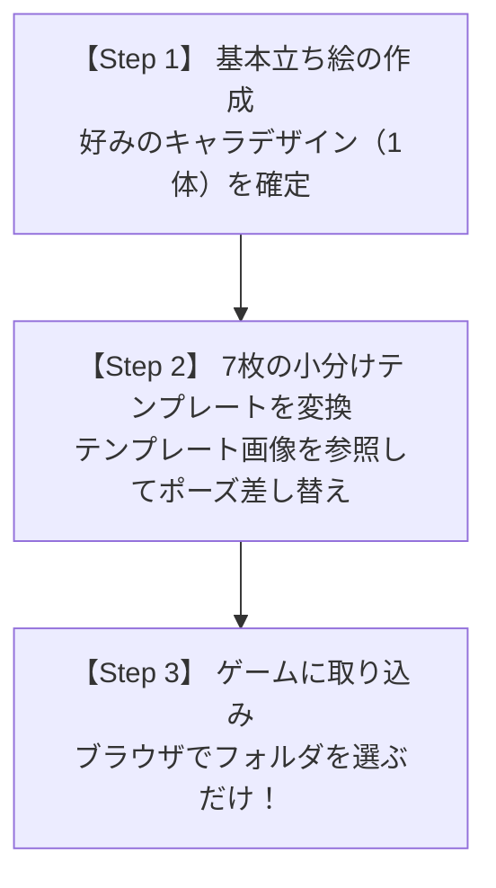

# 🎮 SUNSET RALLY キャラアバター作成手順書（AIチャット依頼用）

このドキュメントは、**ChatGPT (GPT-4o)**、**Claude**、**Gemini**、**Midjourney**、**Stable Diffusion (ControlNet)** などの AI チャットや画像生成ツールに依頼して、本ゲーム（SUNSET RALLY）で動かせるオリジナルキャラアバターを作成するための手順書です。

掲載されているプロンプトをそのままコピー＆ペーストしてご利用いただけます。

---

## 📌 成功のための基本ルール（超重要）

画像生成AIは「1枚の画像に細かなポーズを42体分描かせる」と解像度不足やポーズ崩れを起こします。  
そのため、**以下の3ステップで進めるのが最も高品質で綺麗に仕上がります**。



---

## 🎨 Step 1: 基本立ち絵（キャラクターデザイン）を決める

まず、作りたいキャラクターの見た目（髪型、服装、体格、色）を1枚確定させます。

### 📋 AIチャットに投げるプロンプト（Step 1用）

```text
2Dビーチバレー対戦ゲーム「SUNSET RALLY」のキャラクターグラフィックを作成したいです。
以下の仕様に合わせて、新しいキャラクターの【基本立ち絵（ニュートラル待機ポーズ）】を1枚描いてください。

【仕様要件】
- スタイル: 90年代アーケード格闘ゲーム風の美しいドット絵 / ピクセルアート（SNKやカプコンのクラシック作品スタイル）
- 解像度: 256×256 ピクセル（正方形）
- 構図: 全身が見えるサイドビュー（真横〜やや斜め前向き）、右向き
- アライメント: キャラクターの足元が画像下部から約50px上の位置（地面ライン Y=205）に接地し、水平方向は中央（X=128）に配置
- 背景: 完全透明（透過PNG）または後から切り抜きやすい単色無地背景（#00FF00のグリーンバック等）

【キャラクターの希望設定】
・性別 / 年齢: [例: 20代男性 / スポーティな女性 / ロボット / クマの着ぐるみ など]
・髪型 / 髪色: [例: 黒髪ショート / 金髪ツインテール など]
・衣装 / 配色: [例: 赤いビーチバレーユニフォーム、ハワイアンショーツ など]
・アクセサリー: [例: サングラス、リストバンド、サンバイザー など]
・体格: [例: 筋肉質で引き締まった体格]

まずはこの基本立ち絵を1枚生成してください。
```

> [!TIP]
> 納得のいく立ち絵ができるまで「髪型を〜」「色を〜」とチャット上で修正を重ねてください。この画像が**後続全モーションの見た目の基準（アンカー画像）**になります。

---

## 🏃 Step 2: 7枚の小分けテンプレートを順次変換する

基本デザインが決まったら、`assets/avatar-templates/` にある小分けテンプレート（各 1536×256px、6コマ横並び）の各行を、確定したキャラの見た目で描き直してもらいます。

### 添付するファイル
- **参照画像1**: Step 1 で決まった「基本立ち絵」
- **参照画像2**: 変換対象の小分けテンプレート画像（例: `01-idle-clean.png`）

---

### 📋 AIチャットに投げる共通プロンプト（Step 2用）

```text
先ほど確定した【キャラクター画像（参照1）】のデザインのまま、【添付テンプレート（参照2）】のポーズとコマ送りを完全に踏襲したスプライトシート画像を生成してください。

【厳格な要件】
1. 画像サイズ: 横1536 × 縦256 ピクセル（256×256 ピクセルのコマが横に6コマ並んだ構成）
2. コマ割りとポーズ: 添付テンプレートの各コマ（左から1〜6）のポーズ、四肢の角度、アクション進行を正確に再現すること
3. 地面位置の統一: すべてのコマで、足元の接地ライン（Y=205）および中心位置（各コマのX=128）を厳守すること
4. デザインの一貫性: 参照1の衣装、装飾、配色、体格比率を全コマで統一すること
5. 画風: 16ビット・アーケード格闘ゲーム風のドット絵（ピクセルアート）
6. 背景: 完全透過（またはグリーンバック等の一括透過可能な単色）
```

---

## 📑 各小分けテンプレートの指示プロンプト一覧

各ファイルごとの具体的なアクション内容は以下の通りです。必要に応じてプロンプトに追記してください。

| ファイル名 | カテゴリ | 6コマのアクション内容 | 備考 |
|:---|:---|:---|:---|
| `01-idle-clean.png` | **待機 (Idle)** | コマ1〜6: 呼吸による自然な上下動と構えの待機ループ | 最初に取り組むのがおすすめ |
| `02-run-a-clean.png` | **走り前半 (Run 1-6)** | コマ1〜6: 助走・ダッシュの前半サイクル（足の踏み出しと腕の振り） | 移動アニメの前半 |
| `03-run-b-clean.png` | **走り後半 (Run 7-12)** | コマ7〜12: ダッシュの後半サイクル（02と合わせて1周の走りループ） | 移動アニメの後半 |
| `04-jump-clean.png` | **ジャンプ (Jump)** | コマ1: 踏み込み沈み込み → コマ2: 跳躍上昇 → コマ3: 頂点 → コマ4: 下降 → コマ5: 着地構え → コマ6: 着地硬直 | 空中での足の引き上げを再現 |
| `05-attack-clean.png` | **アタック (Attack)** | コマ1: 踏み込み → コマ2: タメ → コマ3: スイング始動 → コマ4: ボールインパクト → コマ5: フォロースルー → コマ6: 振り抜き | スパイクの全身連動 |
| `06-defense-clean.png` | **守備 (Defense)** | コマ1-2: アンダーハンドレシーブ構え＆ヒット<br>コマ3-4: オーバーハンドトス構え＆ヒット<br>コマ5-6: ブロック跳躍（判定中＆空振り） | 各2コマずつ守備の基本動作 |
| `07-special-serve-clean.png` | **特殊・サーブ** | コマ1: ブロック成功ポーズ<br>コマ2-4: フライングレシーブ（ダイブ・腹這い・起き上がり）<br>コマ5-6: サーブ（ボール保持・トスアップ） | 特殊アクション |

---

## 🎮 Step 3: ゲームへの取り込みと確認

生成した画像をゲームで動かします。**2つの方法**があります。

### 方法 A: ブラウザの「フォルダからアバター追加」ボタンを使う（最速・おすすめ）

1. PC上に新しいフォルダ（例: `my-avatar/`）を作成します。
2. そのフォルダの中に、生成した画像（`01-idle-clean.png` 〜 `07-special-serve-clean.png`、または統合シート `sheet.png`）を入れます。
3. （任意）`portrait.png`（256×256のアイコン画像）や `avatar.json` も一緒に入れておくと名前が表示されます。
4. ゲームの **PLAYER SETUP** 画面下部にある **「📁 フォルダからアバターを追加」** ボタンをクリック。
5. 作成したフォルダを選択するだけで、**即座にアバターリストに追加**され、試合でプレイ可能になります！

---

### 方法 B: リポジトリの `assets/avatars/` に常設保存する

ゲーム本体に永続的に組み込みたい場合の手順です。

1. `assets/avatars/<キャラID>/` フォルダを作成します。
   例: `assets/avatars/cyber-ninja/`
2. フォルダ内に以下のファイルを配置します：
   - `avatar.json`（設定ファイル、下記ひな形参照）
   - `portrait.png`（カード用アイコン 256×256px）
   - `sheet.png`（統合シート）または小分け画像 7枚
3. `assets/avatars/manifest.json` に新キャラを追加します：
   ```json
   {
     "id": "cyber-ninja",
     "name": "サイバー忍者",
     "folder": "cyber-ninja"
   }
   ```
4. ブラウザをリロードすると、PLAYER SETUP のアバター切り替え候補に自動で表示されます。

---

## 📄 付録: `avatar.json` のひな形テンプレート

フォルダ内に配置する設定ファイルのテンプレートです。

### 統合シート（1枚画像 1536×1792）の場合
```json
{
  "id": "my-hero",
  "name": "マイヒーロー",
  "author": "あなたの名前",
  "description": "オリジナル作成アバター",
  "version": "1.0",
  "type": "sheet",
  "sheet": "sheet.png",
  "portrait": "portrait.png"
}
```

### 小分けファイル（7枚画像）の場合
```json
{
  "id": "my-hero-split",
  "name": "マイヒーロー (小分け)",
  "author": "あなたの名前",
  "version": "1.0",
  "type": "split",
  "portrait": "portrait.png",
  "parts": {
    "idle": "01-idle-clean.png",
    "runA": "02-run-a-clean.png",
    "runB": "03-run-b-clean.png",
    "jump": "04-jump-clean.png",
    "attack": "05-attack-clean.png",
    "defense": "06-defense-clean.png",
    "special": "07-special-serve-clean.png"
  }
}
```

---

## 💡 よくある質問とTips

### Q1: 背景が透明にならない
- AIチャットに「背景を完全な単色（#00FF00 の鮮やかなグリーンなど）にしてください」と指示し、無料のWebツール（例: remove.bg、Photoshop、GIMP等）でグリーン部分を透明化してPNG保存してください。

### Q2: ゲーム内で足が地面に浮いてしまう・埋まってしまう
- 各コマの足元の接地ラインが **画像の下から約50px上（Y=205）** に合っているか確認してください。テンプレート画像（`*-guide.png`）を半透明で重ねると簡単に位置合わせができます。

### Q3: 走りモーションが滑って見える
- 走りは `02-run-a`（1〜6）と `03-run-b`（7〜12）の計12コマで1周します。左右の足が交互に地面を蹴るようにコマ順が並んでいることを確認してください。
