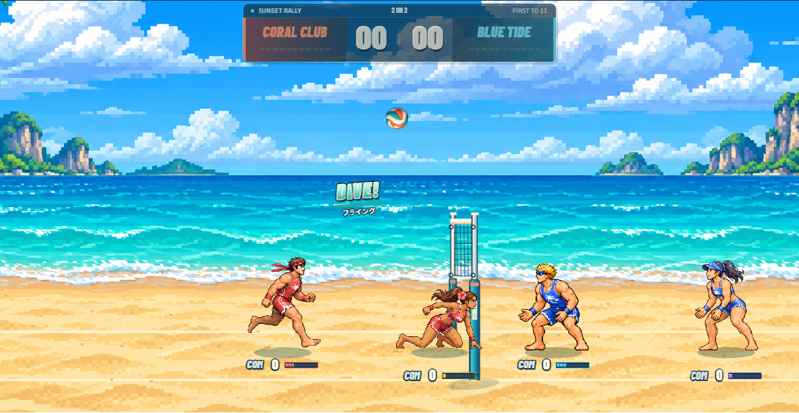

# SUNSET RALLY (サンセット・ラリー)

🎮 **[今すぐブラウザでプレイする (無料・インストール不要)](https://aoi68k.github.io/ai-beach-volley/)**

真横から見る 2対2 ビーチバレーのブラウザ対戦ゲーム。  
PC・スマホのブラウザでアクセスするだけですぐにプレイ＆オンライン対戦できます。



---

## 🎮 ゲーム概要 & ルール

- **試合形式**: 2 vs 2 ビーチバレー
- **勝利条件**: 11点先取（相手コートの砂浜にボールを落とすと1点）
- **基本ルール**:
  - タッチ回数制限なし（何度でも味方同士でラリー可能）
  - 画面外へのボールロストを防ぐため、左右端の壁と天井は反射
  - 全員COM対戦、1〜4人のローカル対戦、WebRTCによる最大4端末のオンライン対戦に対応
  - 試合前の **PLAYER SETUP** で各キャラクターの操作担当（1P〜4P / COM）を自由に設定可能

---

## 🕹️ 操作方法

### 操作キー一覧（キーボード & ゲームパッド）

| プレイヤー | 移動 (左右) | ジャンプ (上) | 下方向 | Aボタン (打球 / アタック / サーブ) | Bボタン (トス / ブロック) |
| :--- | :--- | :--- | :--- | :--- | :--- |
| **1P** | `←` / `→` | `↑` | `↓` | `Z`（または `A`） | `X`（または `B`） |
| **2P** | `F` / `H` | `T` | `C` | `G` | `V` |
| **3P** | `J` / `L` | `I` | `N` | `K` | `M` |
| **4P** | テンキー `4` / `6` | テンキー `8` | テンキー `5` | テンキー `1` | テンキー `2` |
| **ゲームパッド** | 左スティック / 十字キー左右 | 左スティック / 十字キー上 | 左スティック / 十字キー下 | 南ボタン（A / ✕） | 東ボタン（B / ◯） |

- **システム操作**:
  - `Space`: 一時停止 / 再開
  - `R`: タイトルへ戻り試合リセット
  - 全員がCOM操作の対戦時は、ウィンドウフォーカス喪失時（別タブ移動など）でも自動ポーズせず観戦を継続可能

### コントローラー設定（GAMEPAD CONFIG）
画面上部の「01 / SETTING & PRACTICE」から **GAMEPAD CONFIG** ダイアログを開けます。  
- 複数台のゲームパッド（最大4台）を接続時、1P〜4Pそれぞれにどのコントローラーを使用するか個別に指定可能
- ボタンやスティックの割り当てを画面上でキャプチャして自由にカスタマイズ可能
- 設定内容はブラウザのローカルストレージへ自動保存

---

## 🏐 アクション & テクニック

### 基本アクション

- **レシーブ** (`地上 A` / `長押し`):
  - A長押しで構え（横移動不可）。
  - `前＋A` で相手コートへ返球、`Aのみ` で自陣ネット前へ返球。
  - 離れた球へ移動しながらAを押すと **フライングレシーブ**（飛び込み）が発動し、遠くのボールを高く拾い上げます。
- **トス** (`地上/空中 B`):
  - 自陣へトスを上げます。
  - `下＋B` で通常より高い山なりの **高トス** を上げられます。
- **アタック / スパイク** (`空中 A`):
  - 空中でA長押しにより **チャージ** が蓄積され、最大30F（0.5秒）で弾速上限が1.5倍まで向上（残像エフェクトと金色のオーラをまとう）。
  - `前＋A` でネット頂上より上を狙い相手コート奥へ突き刺すドライブスパイク。
- **クイック** (`味方トスの上昇中に空中 A`):
  - 味方のトス（またはパワーレシーブ）が上昇中の早いタイミングで空中アタックすると黄色く発光して自動発動。
- **ダブルアタック** (`味方の返球に空中 Aを重ねる`):
  - 味方が返球した球にもう1人が空中でアタックを重ねるとオレンジ色に発光して発動。相手の入力硬直を増加させノックバックさせます。
- **フェイント** (`空中 後ろ＋A`):
  - ブロック判定で防がれない（ブロック無効）軟打。
  - ネット通過直後からトップスピンによるドライブ急降下がかかり、自然落下より素早く相手コートのネット際へ急降下します。
- **ブロック** (`空中 B`):
  - 相手のスパイクをネット際で阻止。
  - **キルブロック**（ネット直上・相手コート側で接触）: 相手の足元砂浜へドカンと叩き落とす超高速ブロック（約500〜560px/秒）。
  - **ソフトブロック**（自陣側で接触）: ネットを安全に飛び越える山なりの緩やかな返球（約110〜200px/秒）。

### サーブ
サーバーはコート外でボールを持って開始（最初はCORAL、得点後は得点チームがサーブし、ペア内で交代）。
- **ジャンプサーブ (`A`)**:
  - Aでボールを前方へトスアップ → ジャンプして空中でAを押して打球。
  - 打球する瞬間の方向キーで球種を打ち分け可能：
    - `方向なし`: 通常アタックと同じ軌道
    - `前＋A`: 低空で突き刺す高速サーブ
    - `上＋A`: ネット通過後に急降下するドライブサーブ（ブロック不可）
    - `後ろ＋A`: ゆっくり山なりの緩急サーブ
- **地上サーブ (`B`)**:
  - 地上でBを押すと、相手コート中央へ高く山なりの安全送球。
- ※トスを打ち損ねて地面に落ちた場合は、得点にならず同じ選手で再サーブとなります。

---

## ⚡ スペシャル技（SP必殺技）

ネットを越えて相手コートへボールを返球すると、自チーム全員にゲージが付与されます。
- 基本増加量：返球までのチーム内タッチ数（1回:1pt、2回:2pt、3回:3pt、4回:1pt、5回以上:0pt）
- スパイクした本人にはボーナス +2pt
- **10pt貯まると1spを獲得**（最大9spまで蓄積可能）。

打球成立時に1spを消費して発動（発動時は画面暗転、属性色残像、衝撃波リング、スパークの専用カットイン演出）。

| 技名 | コマンド | 消費 | 特徴・効果 |
| :--- | :--- | :---: | :--- |
| **モズ落とし** | 空中 `下＋B` | 1sp | ボールを高く打ち上げ、相手コート上空から垂直に急降下する必殺トス。ブロック不可。 |
| **パワーアタック** | 空中 `下＋A` | 1sp | 青く輝く超強力スパイク。受球した相手を強制ノックバック（地上受けは弱、空中受けは強）し、球を高く弾く。 |
| **パワーサーブ** | サーブトス後、空中 `下＋A` | 1sp | 青い超高速・低空サーブ。受球した相手を地上・空中問わずノックバックし、球は真上へ跳ねる。 |
| **パワーレシーブ** | 地上 `下＋A` | 1sp | 緑色に光る球を上げる。相手のパワーアタック・パワーサーブ・ダブルアタックのノックバックを**完全無効化**。自陣ネット手前へふわりと上がり、味方は即座にクイック可能。 |

### ノックバック仕様
- **弱（初速900）**: パワーアタック地上受け
- **中（初速1300）**: ダブルアタック被弾、パワーサーブ被弾
- **強（初速1800）**: パワーアタック空中受け
- 被弾時は足元の砂浜から砂煙が吹き上がり、摩擦でスライドする間も砂埃が連続発生します。

---

## 🤖 COMのAI特性

- **戦況に応じた判断**:
  - ネットに近い選手が相手のアタックやトスを予測してブロックに跳び、もう1人はレシーブに備えます。
  - アタックがブロックされた履歴を記憶し、止められやすい状況ではフェイントを混ぜて揺さぶりをかけます。
- **多彩なスパイク打点**:
  - ネット頂上付近の高打点スパイク（地上高95〜130px、約65%）を主軸としつつ、中打点（約20%）や低空クイック（約15%）を織り交ぜて自然に攻撃します。
- **SP技の活用**:
  - COMもSPを蓄積し、空中で打球できる場面では50%の確率でモズ落としやパワーアタックを打ち分けます。

---

## 🌐 オンライン対戦 (WebRTC)

PeerJS（同梱）を利用した P2P オンライン通信対戦に対応しています（最大4端末）。

1. タイトルの PLAYER SETUP で **「オンラインの部屋を作る」** をクリック。
2. 表示された招待リンクをコピーして対戦相手に共有。
3. 相手はブラウザでリンクを開き **「参加する」** をクリック。
4. ホスト側で各プレイヤーの操作担当（参加者 / COM）を割り当て、**「この担当で試合開始」**。

> [!NOTE]
> - ホストが物理演算とCOM判定を一括管理し、各クライアントへ毎秒30回状態を同期します。
> - 未割当の参加者は観戦モードとなります。
> - TURNリレーサーバーは使用していないため、対称NATや企業内ネットワークでは接続できない場合があります。その場合は一般回線やモバイルテザリング等をご利用ください。

---

## 🧪 練習 & 挙動チェックモード

画面上部の「01 / SETTING & PRACTICE」にある **「キャラ挙動チェック」** で、1キャラクターのみを操作する練習モードを起動できます。
- ネット付近からボールが真上に打ち上げられ、地面に落ちるたびに再びトスアップ。
- 通常の得点や返球判定はなく、プレイ中は1秒ごとにゲージが2pt自動増加するため、必殺技やジャンプ打点の練習に最適です。
- `Space` で一時停止、`R` で位置リセット、「試合の設定に戻る」で通常ロビーに復帰します。

---

## 🎭 キャラアバター管理 & 追加方法

試合前の **PLAYER SETUP** で、各選手の見た目（アバター）を「標準（チームキャラ）」からカスタムアバターへワンクリックで切り替えることができます。

### アバターのフォルダ構成
複数のアバターは `assets/avatars/` 配下のサブフォルダ単位で管理されます。

```text
assets/avatars/
  manifest.json               # 登録アバター一覧
  chen/                      # 自作カスタムアバターの例
    avatar.json              # アバター定義（名前・作者・形式など）
    portrait.png             # UI表示用アイコン (256x256px)
    01-idle-clean.png        # 待機 (6コマ)
    02-run-a-clean.png       # 走り前半 (6コマ)
    03-run-b-clean.png       # 走り後半 (6コマ)
    04-jump-clean.png        # ジャンプ〜着地 (6コマ)
    05-attack-clean.png      # アタック踏み込み〜着地 (6コマ)
    06-defense-clean.png     # 守備 (レシーブ/トス/ブロック 6コマ)
    07-special-serve-clean.png # 特殊 (ブロック成功/フライング/サーブ 6コマ)
  coral-split/               # 1P: コーラル男性 (小分け形式)
  coral-female-split/        # 2P: コーラル女性 (小分け形式)
  blue-male-split/           # 3P: ブルー男性 (小分け形式)
  blue-female-split/         # 4P: ブルー女性 (小分け形式)
```

### アバターの作り方 & 読み込み
> [!TIP]
> 他のAIチャット（ChatGPT、Claude、Midjourney等）に投げて描いてもらうための詳細なプロンプトや手順は、**[HOW_TO_MAKE_AVATAR.md](file:///s:/work/ai-beachvolley/HOW_TO_MAKE_AVATAR.md)** にまとめています。コピペでそのまま依頼できます。

1. **テンプレートの利用**:
   `assets/avatar-templates/` に各モーションの小分け画像（clean版・guide版）および全モーション概要図が用意されています。
2. **AI画像生成・編集**:
   小分け画像（各 1536×256px、地面ライン Y=205）をベースに、ControlNet や画像生成AIでポーズを維持してキャラを変換します。
3. **ゲームへの追加**:
   - **リポジトリに追加する場合**: `assets/avatars/<フォルダ名>/` を作成し、画像を配置して `assets/avatars/manifest.json` に追記します。
   - **ブラウザから即座にテストする場合**: PLAYER SETUP の **「📁 フォルダからアバターを追加」** ボタンから、作成したフォルダ（または画像群）を選択するだけで、リロードなしで即座にカスタムアバターとして使用可能です。

---

## 🛠️ 開発者向け情報

### ローカル実行 & テスト

```bash
# 開発サーバー起動 (http://127.0.0.1:8767)
npm start

# 単体テスト実行 (アニメーション・物理・ネットワーク・ゲームパッド)
npm test

# E2E ブラウザテスト実行 (Playwright)
npm run test:browser
```

### GitHub Pages 自動公開
リポジトリを GitHub に push すると、`.github/workflows/pages.yml` により自動テスト後に GitHub Pages へデプロイされます。

### プロジェクト構成
- [index.html](file:///s:/work/ai-beachvolley/index.html): メイン画面・ゲームキャンバス・UI
- [js/game.js](file:///s:/work/ai-beachvolley/js/game.js): ゲームループ、物理演算、描画処理、COM思考ロジック
- [css/style.css](file:///s:/work/ai-beachvolley/css/style.css): レトロスポーツ中継風UIスタイル、GPUレイヤー最適化
- [js/audio.js](file:///s:/work/ai-beachvolley/js/audio.js): Web Audio API による効果音合成エンジン
- [js/avatar.js](file:///s:/work/ai-beachvolley/js/avatar.js): キャラアバター管理・小分け/統合スプライト描画システム
- [js/gamepad-config.js](file:///s:/work/ai-beachvolley/js/gamepad-config.js): ゲームパッド設定UI・入力リマッピング
- [js/lobby.js](file:///s:/work/ai-beachvolley/js/lobby.js): PeerJS を用いた P2P ルーム管理・通信同期
- [js/frame-data.js](file:///s:/work/ai-beachvolley/js/frame-data.js): ゲーム内フレームデータ表生成
- [character-preview.html](file:///s:/work/ai-beachvolley/character-preview.html): キャラクタースプライトのアニメーションプレビュー
- `assets/avatars/`: フォルダ毎に管理される複数キャラアバター定義と画像アセット
- `assets/avatar-templates/`: AI画像生成用の42モーション小分けテンプレート群
- `assets/`: キャラクタースプライト、背景、アート設定ドキュメント
